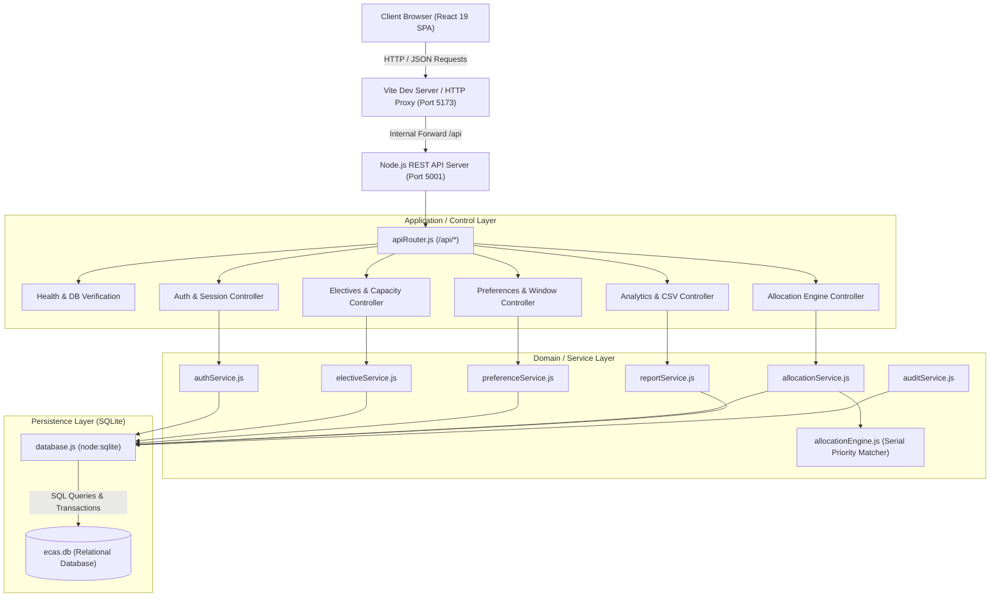
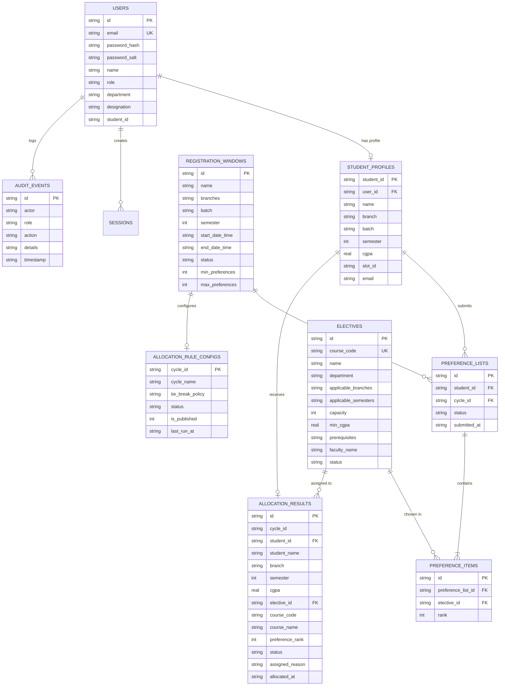
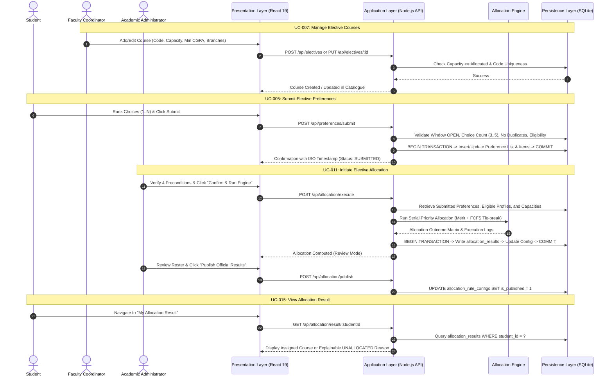

# Elective Course Allocation System (ECAS)

**Course:** Software Development Laboratory (SDE-LAB)  
**Institution:** The LNM Institute of Information Technology, Jaipur  
**Team ID:** T016  
**Team Members:** Krishangee Tayal, Mudit Kumar Dwivedi, Lakshit Agarwal, Ananya Surana  
**Project Status:** Final Implementation & Demonstration System  
**Deployment Mode:** 100% Local Execution (No external cloud hosting required)

---

## 1. Project Title
**Elective Course Allocation System (ECAS)** — Automated Preference Collection, Validation & Deterministic Seat Allocation.

---

## 2. Project Overview
The **Elective Course Allocation System (ECAS)** is an integrated web platform engineered to automate the collection, validation, and deterministic allocation of institutional elective courses. Replacing antiquated first-come-first-served (FCFS) slot racing, ECAS establishes an equitable, transparent, and auditable academic workflow. Students submit ranked elective preferences, which an automated allocation engine evaluates against student academic eligibility, course seat limits, and approved tie-breaking criteria.

---

## 3. Problem Statement
In traditional academic registration systems, elective course registration often suffers from:
- **Server Concurrency Bottlenecks:** Network races during slot opening windows penalize students with slower connections.
- **Sub-optimal Academic Outcomes:** Students register hastily without considering prerequisite depth or course suitability.
- **Lack of Transparency & Auditability:** Manual seat adjustments and opaque waitlists cause student dissatisfaction.
- **Seat Utilization Waste:** Popular courses experience artificial fill while secondary preferences remain unfilled due to rigid drop-add cycles.

ECAS resolves these issues by decoupling preference submission from seat allocation, collecting ranked choices over an extended window and executing an atomic, deterministic allocation pass.

---

## 4. Project Objectives
1. Provide role-specific web interfaces for Students, Faculty Coordinators, Academic Administrators, and System Administrators.
2. Enforce strict multi-level eligibility criteria (degree branch restrictions, semester validity, and minimum CGPA cutoffs).
3. Validate student preferences against duplicate selections, inactive courses, and minimum/maximum choice boundaries.
4. Execute an automated, deterministic allocation engine utilizing the **Serial Priority Matching Model** with transparent tie-breaking rules.
5. Guarantee strict capacity invariants (no course exceeds its seat quota; each student receives at most one course).
6. Persist all records, preference lists, allocation outcomes, and audit logs in an ACID-compliant relational database (SQLite).
7. Ensure 100% reproducible local execution with zero cloud hosting dependencies.

---

## 5. Main Features
- **Persona Quick-Access & Secure Session Management:** Demo switchers and password-authenticated login (`demo123`).
- **Dynamic Catalogue & Live Vacancy Calculation:** Real-time visibility into available seats, total capacity, and eligibility tags.
- **Drag-and-Drop / Move-Rank Preference Builder (UC-005):** Contiguous choice ranking with duplicate prevention and draft autosaving.
- **Faculty Course Management Console (UC-007):** Add/edit electives, configure capacities, set eligibility cutoffs, and prevent capacity reductions below allocated seats.
- **Allocation Administration Console (UC-011):** 4-point precondition checklist, tie-breaking policy selector, atomic engine execution, live execution trace console, and two-phase result publication.
- **Individual Student Outcome View (UC-015):** Exposes only the logged-in student's result with full decision explainability.
- **Institutional Analytics & CSV Reporting (UC-013 / UC-016):** Key KPI cards, preference rank satisfaction distribution, course-wise seat fill bars, and downloadable CSV audit roster.
- **1-Click Canonical Seed Data Reset:** Instant baseline restoration for clean, repeatable evaluation demonstrations.

---

## 6. User Roles and Permissions

| Capability / Action | Student | Faculty Coordinator | Academic Administrator | System Administrator | Enforcement Location |
|---|:---:|:---:|:---:|:---:|---|
| **View Academic Profile** | Yes | No | Yes | Yes | `StudentDashboard.jsx` |
| **Browse Elective Catalogue** | Yes | Yes | Yes | Yes | `ElectivesCatalogue.jsx` |
| **Build & Rank Preferences** | Yes | No | No | No | `PreferenceBuilder.jsx` |
| **Submit Preferences (UC-005)** | Yes | No | No | No | `preferenceService.js` / API |
| **Reopen Submitted Choices** | Yes (if window open) | No | No | No | `preferenceService.js` / API |
| **Create & Edit Electives (UC-007)** | No | Yes | Yes | Yes | `electiveService.js` / API |
| **Configure Capacity & Cutoffs** | No | Yes | Yes | Yes | `electiveService.js` / API |
| **Verify Readiness Preconditions** | No | No | Yes | Yes | `allocationService.js` / API |
| **Configure Tie-Breaking Rule** | No | No | Yes | Yes | `allocationService.js` / API |
| **Execute Allocation Engine (UC-011)** | No | No | Yes | Yes | `allocationService.js` / API |
| **Publish Allocation Results** | No | No | Yes | Yes | `allocationService.js` / API |
| **Inspect Aggregate Analytics** | No | Yes (Summary) | Yes (Full) | Yes (Full) | `ReportsPage.jsx` |
| **View Own Allocation Result** | Own Only | Scoped | Full Roster | Full Roster | `StudentResultView.jsx` |
| **Factory Seed Data Reset** | No | No | Yes | Yes | `server/db/seed.js` / API |

---

## 7. Technology Stack

- **Presentation Layer (Frontend):**
  - **React 19** with JSX component hierarchy.
  - **Vite 6** for rapid ESM bundling, Hot Module Replacement (HMR), and API middleware routing.
  - **Vanilla CSS Design Tokens (`src/index.css`):** Academic administration design guidelines (Navy/Slate `#1e3a8a`, responsive grids, accessible contrast).
  - **Lucide React:** Operational iconography and visual status indicators.
- **Application / Control Layer (Backend):**
  - **Node.js (v24.x / v22.x):** Native HTTP server and REST router (`server/routes/apiRouter.js`).
  - **Node Native Crypto (`node:crypto`):** SHA-256 cryptographic password hashing with unique salts, session token generation.
- **Domain / Service Layer:**
  - Modular business services (`server/services/` & `src/services/`): `authService`, `electiveService`, `preferenceService`, `allocationService`, `reportService`, `auditService`.
  - Pure deterministic algorithm module (`src/services/allocationEngine.js`).
- **Persistence Layer (Database):**
  - **SQLite 3 (`node:sqlite` - DatabaseSync):** Genuine relational database stored locally in `ecas.db`.
  - Foreign key constraints (`PRAGMA foreign_keys = ON`), Write-Ahead Logging (`PRAGMA journal_mode = WAL`), and ACID transactions (`BEGIN IMMEDIATE TRANSACTION`).
- **Testing & Verification:**
  - **Vitest 2.1:** Automated test runner executing 30 unit and end-to-end integration tests.

---

## 8. System Architecture



---

## 9. Four-Layer Architecture

Organized according to the software engineering principles established in Assignment 6:

```mermaid
flowchart LR
    L1["Layer 1: Presentation Layer<br/>(React 19, UI Components, Pages)"]
    L2["Layer 2: Application / Control Layer<br/>(REST Endpoints, Input Validation, Auth)"]
    L3["Layer 3: Domain / Service Layer<br/>(Business Logic, Allocation Engine, Policies)"]
    L4["Layer 4: Persistence Layer<br/>(SQLite database.js, ecas.db, Transactions)"]

    L1 -->|REST API Calls (fetch)| L2
    L2 -->|Service Invocations| L3
    L3 -->|Prepared Statements / Transactions| L4
```

### Layer Mapping
1. **Layer 1: Presentation Layer (`src/pages/`, `src/components/`):**
   - Renders role-specific dashboards, modal dialogs, and interactive tables.
   - Communicates exclusively with Layer 2 via HTTP REST endpoints (`src/services/apiClient.js`). Never accesses the database directly.
2. **Layer 2: Application / Control Layer (`server/routes/apiRouter.js`, `server/index.js`):**
   - Coordinates HTTP requests, validates payloads, enforces role-based access control, and serializes responses.
3. **Layer 3: Domain / Service Layer (`server/services/`, `src/services/`):**
   - Implements core business rules: course capacity bounds, prerequisite checks, duplicate prevention, and the deterministic serial priority allocation engine.
4. **Layer 4: Persistence Layer (`server/db/database.js`, `server/db/schema.sql`):**
   - Maintains relational integrity via SQLite foreign keys, transactions, and unique constraints.

---

## 10. Component Responsibilities

| Component / Module | Path | Primary Responsibilities |
|---|---|---|
| `apiClient.js` | `src/services/apiClient.js` | Centralized fetch client managing Bearer authentication headers, token storage, and API error formatting. |
| `apiRouter.js` | `server/routes/apiRouter.js` | Dispatches `/api/*` requests to domain services; verifies tokens and role authorization. |
| `database.js` | `server/db/database.js` | Manages SQLite connection lifecycle, schema initialization, connection health checks, and transactions. |
| `seed.js` | `server/db/seed.js` | Safe, idempotent seed data importer populating canonical demo records into `ecas.db`. |
| `authService.js` | `server/services/authService.js` | Cryptographic password hashing (SHA-256), session generation, user and student profile resolution. |
| `electiveService.js`| `server/services/electiveService.js`| Elective catalogue CRUD, live vacancy calculation, capacity reduction integrity guard. |
| `preferenceService.js`| `server/services/preferenceService.js`| Ranked choice draft saving, deadline verification, duplicate prevention, timestamped submissions (UC-005). |
| `allocationEngine.js` | `src/services/allocationEngine.js` | Pure deterministic Serial Priority Matching engine; enforces capacity limits, eligibility invariants, and generates execution logs. |
| `allocationService.js`| `server/services/allocationService.js`| Verifies 4 preconditions, coordinates engine execution in a database transaction, and handles publication (UC-011). |
| `reportService.js` | `server/services/reportService.js` | Generates institutional KPI metrics, rank satisfaction distributions, course occupancy bars, and RFC-compliant CSV export. |
| `auditService.js` | `server/services/auditService.js` | Records immutable audit trail events with actor identity, role, timestamp, and action description. |

---

## 11. Project Folder Structure

```text
D:\Project\SDE-LAB
├── ecas.db                       <-- SQLite relational database file
├── .env.example                  <-- Environment variables template
├── .env                          <-- Local environment configuration
├── package.json                  <-- Project metadata, dependencies & npm scripts
├── vite.config.js                <-- Vite configuration with ECAS API middleware
├── index.html                    <-- Single Page Application HTML root
├── README.md                     <-- Comprehensive project documentation
├── docs/                         <-- Architecture and design documentation
│   ├── architecture.md
│   └── design.md
├── server/                       <-- Backend Server & Persistence Layer
│   ├── index.js                  <-- Standalone HTTP server runner (Port 5001)
│   ├── db/
│   │   ├── database.js           <-- SQLite connection & transaction helpers
│   │   ├── schema.sql            <-- Relational DDL schema
│   │   └── seed.js               <-- Idempotent database seeder
│   ├── routes/
│   │   └── apiRouter.js          <-- REST API routes & controllers
│   └── services/
│       ├── authService.js
│       ├── electiveService.js
│       ├── preferenceService.js
│       ├── allocationService.js
│       ├── reportService.js
│       └── auditService.js
├── src/                          <-- Presentation Layer (Frontend)
│   ├── main.jsx                  <-- React DOM entry point
│   ├── App.jsx                   <-- Core App container & tab navigation
│   ├── index.css                 <-- Design tokens & responsive styling
│   ├── components/               <-- Reusable UI components
│   │   ├── Navbar.jsx            <-- Top bar with Live DB status & persona switcher
│   │   ├── Sidebar.jsx           <-- Role-scoped navigational menu
│   │   ├── Modal.jsx             <-- Accessible dialog component
│   │   └── StatusBadge.jsx       <-- Color-coded status chips
│   ├── data/
│   │   └── seedData.js           <-- Canonical baseline demo data
│   ├── pages/                    <-- User-facing screens
│   │   ├── LoginPage.jsx         <-- Persona quick-login & credential access
│   │   ├── StudentDashboard.jsx  <-- Academic profile & cycle status
│   │   ├── ElectivesCatalogue.jsx<-- Browsable catalogue with eligibility badges
│   │   ├── PreferenceBuilder.jsx <-- Ranked preference builder & submission (UC-005)
│   │   ├── FacultyCourseManagement.jsx <-- Course CRUD & capacity settings (UC-007)
│   │   ├── AllocationAdmin.jsx   <-- Allocation console & engine execution (UC-011)
│   │   ├── ReportsPage.jsx       <-- Institution analytics & CSV export
│   │   ├── StudentResultView.jsx <-- Individual student allocation outcome (UC-015)
│   │   └── SysAdminPage.jsx      <-- System audit logs & factory reset
│   └── services/                 <-- Client-side service bridges
│       ├── apiClient.js          <-- REST fetch client
│       ├── allocationEngine.js   <-- Allocation algorithm
│       └── validationService.js  <-- Business validation helpers
└── tests/                        <-- Automated Test Suite
    ├── allocationEngine.test.js  <-- Engine business rules test suite
    ├── validationService.test.js <-- Domain validation test suite
    └── integration.test.js       <-- End-to-end database integration test suite
```

---

## 12. Database Architecture & Entity Relationships

The relational model is persisted in SQLite (`ecas.db`) with active foreign key constraints:



---

## 13. Database Schema and Constraints
- **Foreign Keys:** Enabled on every connection (`PRAGMA foreign_keys = ON;`). Deleting a user cascades to profile and sessions; deleting a course with existing allocations is blocked.
- **Unique Constraints:**
  - `users(email)` prevents duplicate account registrations.
  - `electives(course_code)` ensures course codes are unique institute-wide.
  - `preference_lists(student_id, cycle_id)` prevents multiple active preference lists for the same student in a single cycle.
  - `preference_items(preference_list_id, elective_id)` strictly prohibits duplicate course selections within the same list.
  - `preference_items(preference_list_id, rank)` guarantees unambiguous sequential choice ordering.
  - `allocation_results(cycle_id, student_id)` guarantees that no student can be allocated more than once per cycle.
- **Check Constraints:**
  - `capacity > 0`: Course seat capacity must be a strictly positive integer.
  - `cgpa >= 0.0 AND cgpa <= 10.0`: Validates GPA boundaries.
  - `role IN ('student', 'faculty', 'admin', 'sysadmin')`.
  - `status IN ('ALLOCATED', 'UNALLOCATED')`.

---

## 14. Authentication and Authorization
- **Credential Storage:** User passwords are stored using salted SHA-256 hashes (`password_hash` and `password_salt` columns in `users` table).
- **Session Tokens:** Successful login generates a unique cryptographically random token (`sess_<UUID>`) saved in the `sessions` table.
- **Authorization Guard:** Protected endpoints in `server/routes/apiRouter.js` extract the token via HTTP header `Authorization: Bearer <token>`, resolve user identity and role from the database, and verify endpoint permissions:
  - Students cannot create electives, access other students' results, or trigger allocation.
  - Faculty Coordinators cannot initiate allocation or publish results.
  - Only Academic Administrators (`admin` or `sysadmin`) can trigger the allocation engine and publish official outcomes.

---

## 15. Core Workflows



### Detailed Use Case Rules:
- **UC-005 (Submit Preferences):**
  - Registration window must be in `OPEN` status.
  - Minimum 3 choices, maximum 5 choices.
  - Duplicate elective selections within the submission are immediately rejected.
  - Ineligible choices (branch mismatch, semester mismatch, or student CGPA below course cutoff) are flagged and blocked.
  - Once submitted, preferences are locked unless the student explicitly clicks "Modify Submitted Choices" within the open window.
- **UC-007 (Manage Courses):**
  - Course code must be unique across the institution.
  - Capacity must be a positive integer ($> 0$).
  - Faculty cannot reduce seat capacity below the count of students already allocated to that course.
- **UC-011 (Initiate Allocation):**
  - Preconditions verified: active courses exist, all capacities positive, submitted preferences exist, approved policy set.
  - Priority queue: Students sorted deterministically by CGPA descending, FCFS timestamp ascending, and Student ID ascending.
  - Single course invariant: At most one course allocated per student.
  - Capacity limit invariant: Course allocated count strictly $\le$ capacity.
  - Two-phase lifecycle: Computed Review $\rightarrow$ Official Publication.

---

## 16. Allocation Logic and Tie-Breaking Configuration
The allocation engine (`src/services/allocationEngine.js`) executes the **Serial Priority Matching Model**:

$$\text{Priority Rank} = \operatorname{sort}\Big(\text{CGPA} \downarrow, \;\; \text{Submission Timestamp} \uparrow, \;\; \text{Student Roll No} \uparrow\Big)$$

### Step-by-Step Execution:
1. **Filtering:** Only students with `status === 'SUBMITTED'` for the active cycle are loaded.
2. **Deterministic Priority Queue:**
   - **Primary Key:** Cumulative GPA descending (Merit).
   - **Secondary Key (Tie-break):** Preference list submission timestamp ascending (First-Come, First-Served).
   - **Tertiary Key (Final Tie-break):** Student Roll Number ascending (guaranteeing 100% mathematical reproducibility).
3. **Sequential Preference Evaluation:**
   - For each student in priority order, choices are evaluated in rank order ($1, 2, 3 \dots$).
   - **Eligibility Check:** Branch matches scope, semester matches scope, and student CGPA $\ge$ course minimum cutoff.
   - **Capacity Check:** Total seats already allocated to this course $<$ course capacity.
4. **Assignment:**
   - If eligible and seats remain, the student is assigned to that course and its remaining seats decrement.
   - If full or ineligible, the specific reason is recorded in the execution log and the engine moves immediately to the next preference.
   - If all preferences are exhausted without an assignment, the student is marked `UNALLOCATED` with an explicit, explainable reason.

---

## 17. Implemented API Endpoints

### Health & Database
- `GET /api/health` — Verifies database connectivity, SQLite engine health, and table counts.

### Authentication & Users
- `POST /api/auth/login` — Authenticates user with email/password; creates session token.
- `POST /api/auth/logout` — Terminates active session.
- `GET /api/auth/me` — Retrieves authenticated user identity and student academic profile.
- `GET /api/users` — Lists all registered users (used by demo persona switcher).
- `GET /api/students` — Lists all student academic profiles.

### Elective Courses (UC-007)
- `GET /api/electives` — Retrieves all electives with live calculated vacancies.
- `GET /api/electives/student/:studentId` — Retrieves electives with individual student eligibility flags.
- `POST /api/electives` — Creates a new elective course (Faculty / Admin only).
- `PUT /api/electives/:id` — Updates elective details and capacity with reduction guards.
- `DELETE /api/electives/:id` — Removes an elective with zero active allocations.

### Preferences & Registration Windows (UC-005)
- `GET /api/preferences/window` — Returns the active registration window and deadlines.
- `GET /api/preferences/windows` — Returns all registration windows.
- `GET /api/preferences/list/:studentId` — Returns a student's preference list and ranked items.
- `POST /api/preferences/draft` — Persists unsubmitted draft preference choices.
- `POST /api/preferences/submit` — Validates and submits ranked preferences in a transaction.
- `POST /api/preferences/reopen` — Reopens submitted preferences for modification within open window.

### Allocation Administration (UC-011 & UC-015)
- `GET /api/allocation/readiness` — Evaluates the 4 allocation preconditions.
- `GET /api/allocation/config` — Retrieves allocation rule configuration and tie-break policy.
- `PUT /api/allocation/config` — Updates tie-break policy and configuration.
- `POST /api/allocation/execute` — Executes the deterministic allocation engine in a transaction.
- `POST /api/allocation/publish` — Releases computed results to student portals.
- `POST /api/allocation/reset` — Clears allocation results and returns cycle to `NOT_STARTED`.
- `GET /api/allocation/results` — Returns full allocation results roster.
- `GET /api/allocation/result/:studentId` — Returns individual student allocation outcome (UC-015).

### Reports & Audit Trail
- `GET /api/reports/summary` — Returns KPI metrics, rank distributions, and occupancy tables.
- `GET /api/reports/csv` — Exports allocation roster as downloadable CSV.
- `GET /api/audit-events` — Retrieves immutable system audit event log.
- `POST /api/system/reset` — Idempotently restores database to baseline seed state.

---

## 18. Environment Variables

Configured in `.env` (template provided in `.env.example`):

```bash
# Server Port & Binding
PORT=5001
HOST=127.0.0.1
NODE_ENV=development

# Database Path
DATABASE_FILE=./ecas.db

# Authentication Security
SESSION_SECRET=ecas_demo_dev_secret_key_lnmiit_t016
DEMO_USER_PASSWORD=demo123

# Allocation Engine Defaults
DEFAULT_TIE_BREAK_POLICY=CGPA_MERIT
ACTIVE_CYCLE_ID=slot_sem6_active
```

---

## 19. Local Installation Instructions

### Prerequisites
- **Node.js:** v18.0.0 or higher (v24.x recommended for native `node:sqlite`).
- **npm:** v9.0.0 or higher.
- **Git**

### Step 1: Clone Repository
```bash
git clone <repository-url>
cd SDE-LAB
```

### Step 2: Install Dependencies
```bash
npm install
```

### Step 3: Configure Environment
Copy the environment template:
```bash
cp .env.example .env
```
*(On Windows PowerShell: `Copy-Item .env.example .env`)*

---

## 20. Database Setup and Initialization

Initialize the SQLite database schema and seed the canonical demo dataset:
```bash
npm run db:seed
```

This creates `ecas.db` and populates:
- 13 demo accounts with hashed passwords (`demo123`).
- 10 student academic profiles across CSE, CCE, and ECE.
- 7 elective courses with capacities and eligibility criteria.
- 10 student preference lists configured for demonstration scenarios.
- Active registration window `slot_sem6_active`.

---

## 21. Demo Account Credentials

All demo accounts share the password: `demo123`.  
*(A 1-click persona switcher is also available on the Login page and Top Navbar for rapid demonstration).*

| Role | Demo Email | Password | Persona Name & ID | Demonstration Scenario / Responsibilities |
|---|---|---|---|---|
| **Student (High Merit)** | `student.demo@example.test` | `demo123` | Aarav Sharma (`22UCS001`, CSE, CGPA 9.45) | Submitted preferences; receives Choice #1 (`CS4101 Machine Learning`) on high merit. |
| **Student (Contested Rank)** | `chirag.demo@example.test` | `demo123` | Chirag Mehta (`22UCC007`, CCE, CGPA 8.85) | Contested seat on ML; demonstrates fallback to Choice #2 (`CS4102 Cloud Computing`). |
| **Student (Ineligible Choice)** | `gauri.demo@example.test` | `demo123` | Gauri Iyer (`22UCS045`, CSE, CGPA 7.75) | Ranked Quantum Computing (ineligible due to CGPA < 8.0); engine skips to Choice #2 (`CS4103 Cyber Security`). |
| **Student (Unallocated)** | `ishita.demo@example.test` | `demo123` | Ishita Saxena (`22UCC032`, CCE, CGPA 6.95) | Only ranked courses that reached capacity; demonstrates explainable `UNALLOCATED` status. |
| **Student (Draft / Live)** | `jai.demo@example.test` | `demo123` | Jai Kapoor (`22UCS088`, CSE, CGPA 6.60) | Starts in `DRAFT` status; demonstrates live choice reordering and submission workflow (UC-005). |
| **Faculty Coordinator** | `faculty.demo@example.test` | `demo123` | Dr. Preeti Jain (CSE UG Coordinator) | Course Management (UC-007): add/edit electives, capacities, prerequisites, and eligibility cutoffs. |
| **Academic Administrator** | `admin.demo@example.test` | `demo123` | Prof. S. R. Verma (Dean of Academics) | Allocation Console (UC-011): 4-point readiness checklist, policy selection, run engine, and publish results. |
| **System Administrator** | `sysadmin.demo@example.test` | `demo123` | Mr. Rajeev N. (CIT) | System Console: view users, inspect audit trails, and restore canonical seed database. |

---

## 22. Running the Application Locally

The application can be started using either of the following commands:

### Option A: Single Command (Frontend + Integrated Backend)
```bash
npm run dev
```
- Launches the Vite development server with the integrated ECAS API middleware and SQLite database at `http://localhost:5173/`.

### Option B: Dedicated Backend Server + Frontend Client
In Terminal 1 (Backend REST API & SQLite Database):
```bash
npm run server
```
*(Starts backend on `http://127.0.0.1:5001` with health check at `http://127.0.0.1:5001/api/health`)*

In Terminal 2 (Frontend Client):
```bash
npm run dev
```
*(Opens web interface at `http://localhost:5173/`)*

---

## 23. Step-by-Step Demonstration Walkthrough (Viva Script)

### Step 1 — Open the Application & Inspect Database Status
1. Navigate to `http://localhost:5173/`.
2. Notice the Team T016 institutional header, project overview, and the live status indicator:  
   `DB: SQLite Connected (ecas.db) | ACID Relational`.

### Step 2 — Student Live Submission Workflow (UC-005)
1. In the persona selector or login card, select **Student: Jai Kapoor (`22UCS088`)**.
2. Notice Jai's preference status is currently `DRAFT`.
3. Open **Preference Builder (UC-005)**.
4. Add eligible courses from the dropdown. Use the **Move Up** and **Move Down** buttons to re-rank preferences.
5. Click **Review & Submit Preferences**, review the modal dialog, and confirm submission.
6. Notice the status updates to `SUBMITTED` with an exact ISO timestamp, persisted in `ecas.db`.

### Step 3 — Faculty Course Management (UC-007)
1. Switch role via top navbar to **Faculty Coordinator (Dr. Preeti Jain)**.
2. Navigate to **Course Management (UC-007)**.
3. Click **Add Elective** to demonstrate validation: positive seat integer, branch tags, and minimum CGPA.
4. Edit an existing elective (`CS4102 Cloud Computing`) to demonstrate the capacity reduction guard: reducing capacity below currently allocated students is blocked.

### Step 4 — Allocation Preconditions & Engine Execution (UC-011)
1. Switch role to **Academic Administrator (Prof. S. R. Verma)**.
2. Navigate to **Allocation Console (UC-011)**.
3. Review the **4 Preconditions Checklist** (all green: active electives, positive capacities, submitted lists, approved policy).
4. Review the tie-breaking dropdown (**CGPA Merit with FCFS Tie-Break**).
5. Click **Start Allocation (UC-011)** $\rightarrow$ **Confirm & Run Engine**.
6. Inspect the live **Execution Trace Log Console** displaying sequential student allocations.

### Step 5 — Review Reports & Institutional Analytics
1. Navigate to **Allocation Summaries (Reports)**.
2. Highlight the key evaluation scenarios in the student audit roster:
   - **Aarav Sharma (`22UCS001`)**: CGPA 9.45 $\rightarrow$ Allocated Choice #1 (`CS4101 Machine Learning`).
   - **Chirag Mehta (`22UCC007`)**: CGPA 8.85 $\rightarrow$ ML filled at capacity 2; bumped to Choice #2 (`CS4102 Cloud Computing`).
   - **Gauri Iyer (`22UCS045`)**: CGPA 7.75 $\rightarrow$ Ineligible for Choice #1 (`CS4105 Quantum Computing`, min CGPA 8.0); engine skipped to Choice #2 (`CS4103 Cyber Security`).
   - **Ishita Saxena (`22UCC032`)**: CGPA 6.95 $\rightarrow$ Ranked only courses that reached full capacity; marked `UNALLOCATED` with explicit reason.
3. Click **Export CSV** to demonstrate downloading the complete allocation roster.

### Step 6 — Publish Results & Verify Student View (UC-015)
1. Return to **Allocation Console** and click **Publish Official Results**.
2. Switch role back to **Student (Aarav Sharma)** and navigate to **My Allocation Result**.
3. Confirm that the assigned elective (`CS4101 Machine Learning`) and decision rationale are clearly displayed.
4. Switch to **Ishita Saxena** to demonstrate the explainable unallocated notification and waitlist guidance.

### Step 7 — Verify Persistent Relational Storage
1. Refresh the web browser: all submitted preferences, course edits, and allocation results remain 100% intact from `ecas.db`.

---

## 24. Testing and Verification

All 30 automated unit and end-to-end integration tests pass:

```bash
npm test
```

### Test Suite Coverage:
- **`tests/allocationEngine.test.js` (5 tests):**
  - Strict capacity limits (no elective exceeds quota).
  - Ineligible student exclusion (branch and CGPA cutoffs).
  - Preference fallback when first choice reaches capacity.
  - Deterministic tie-breaking reproducibility.
  - Unallocated state assignment when all choices are exhausted.
- **`tests/validationService.test.js` (6 tests):**
  - Duplicate preference selection rejection.
  - Closed-window submission rejection.
  - Minimum/maximum choice boundary enforcement.
  - Role-based authorization guards.
  - Course capacity validation (positive integers and allocation bounds).
  - Canonical seed data reset verification.
- **`tests/integration.test.js` (19 tests):**
  - Genuine SQLite database connectivity and health probe.
  - Multi-table relational persistence across `users`, `student_profiles`, `electives`, `preference_lists`, and `allocation_results`.
  - Password hashing and authentication validation.
  - UC-007 Faculty elective creation and capacity guard.
  - UC-005 Student preference submission and transaction persistence.
  - UC-011 Allocation preconditions, engine execution, publication lifecycle, and CSV export.

---

## 25. Known Limitations
- The system operates strictly in local development environments (`http://localhost:5173/` and `http://127.0.0.1:5001/`); deployment to remote cloud platforms is intentionally omitted per project specifications.
- Registration windows currently operate on configured ISO timestamp strings; calendar integration for Google Workspace / Outlook is left as an institutional enhancement.

---

## 26. Future Enhancements
- Integration with LNMIIT ERP/MIS Single Sign-On (SAML 2.0 / OAuth2).
- Automated spot-round and waitlist resolution rounds for unallocated students.
- Multi-cycle simultaneous registration (e.g. Open Elective + Program Elective concurrent cycles).
- Real-time WebSocket notifications during allocation release.

---

## 27. Team Information

**Team ID:** T016  
**Course:** Software Development Laboratory (SDE-LAB), Spring 2026  
**Institution:** The LNM Institute of Information Technology, Jaipur  

| Name | Roll Number | Primary Contributions |
|---|---|---|
| **Krishangee Tayal** | 22UCS108 | Requirements Engineering (SRS), Use Case Modeling (UC-005, UC-011), Acceptance Testing. |
| **Mudit Kumar Dwivedi** | 22UCS122 | Four-Layer Architecture Design, Domain Services, Validation Engine. |
| **Lakshit Agarwal** | 22UCC058 | Allocation Engine Algorithm, Serial Priority Matcher, Deterministic Tie-breaking. |
| **Ananya Surana** | 22UCS030 | Presentation Layer (React 19 SPA), UI Design Tokens, SQLite Integration & Demonstration Readiness. |
